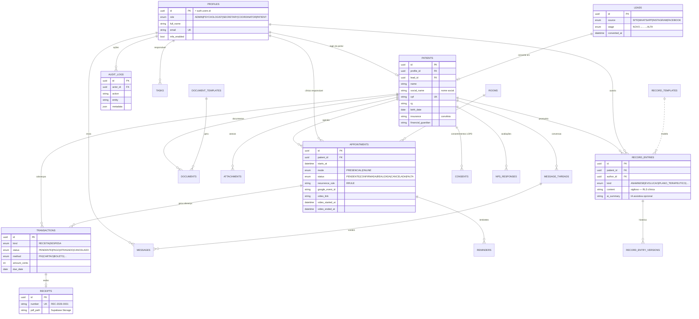

# 03 · Banco de Dados + Diagrama ER

A modelagem Prisma completa está em [`packages/database/prisma/schema.prisma`](../packages/database/prisma/schema.prisma). A migração com RLS, triggers e buckets está em [`supabase/migrations/0001_init.sql`](../supabase/migrations/0001_init.sql).

## Diagrama ER (Mermaid)

## Destaques da modelagem

- **`social_name` e `pronouns`** no paciente — respeito à identidade é requisito de produto, não detalhe.
- **Prontuário versionado por trigger**: todo `UPDATE` em `record_entries` grava o conteúdo anterior em `record_entry_versions` e registra em `audit_logs` automaticamente — exigência ética do CFP de inalterabilidade rastreável.
- **Dinheiro em centavos (`amount_cents`)** — nunca float.
- **Recorrência via RRULE (RFC 5545)** — compatível com Google Calendar desde o dia 1.
- **`reminders` como fila** — o Vercel Cron processa lembretes pendentes (24h/2h) e marca `sent_at`; trocar o canal (WhatsApp/e-mail) não muda o modelo.
- **Lead → Paciente** preserva o lead original (`patients.lead_id`), mantendo a origem para métricas de conversão.
