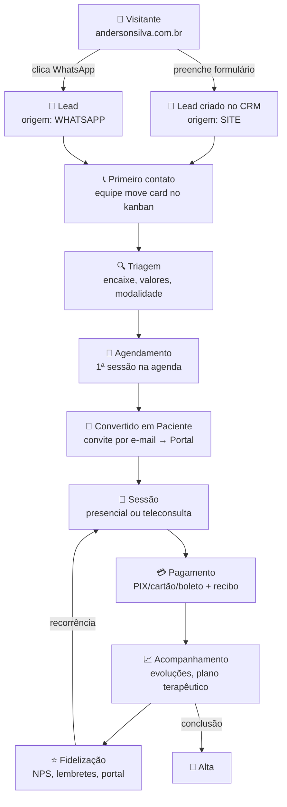
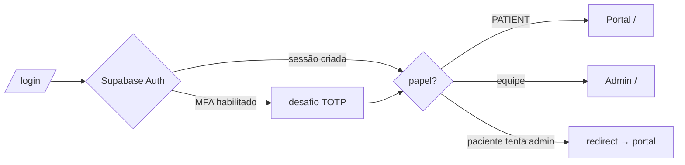

# 05 · Fluxos de Navegação

## Jornada principal (Visitante → Fidelização)



## Mapa de rotas

### Site (`andersonsilva.com.br`)
```
/            home: hero → valores → sobre → serviços → contato/lead
/#contato    formulário → createLead → CRM
/portal      redirect → portal.andersonsilva.com.br
[Header]     "Área do Paciente" sempre visível
```

### Portal do Paciente (`portal.…`)
```
/login       e-mail+senha (Supabase) · MFA opcional
/            Dashboard: saudação, próxima/última sessão, financeiro, avisos
/sessoes     lista com status; botão "Entrar na sessão" (online, ≤15 min antes)
/pagamentos  em aberto + histórico, métodos
/recibos     download de recibos/declarações (URL assinada)
/mensagens   canal seguro com a clínica
/dados       editar contatos · privacidade LGPD
```

### Admin (`admin.…`)
```
/login           somente papéis de equipe
/                Dashboard executivo (8 KPIs + gráficos)
/agenda          semana estilo Google Calendar; salas; status
/pacientes       busca + lista
/pacientes/[id]  cadastro · prontuário (só clínicos) · timeline · financeiro · anexos
/crm             kanban 6 estágios; conversão lead→paciente
/financeiro      KPIs, a receber, a pagar, recibos, relatórios
/documentos      templates: contrato, recibo, declaração, relatório, laudo, termo LGPD
```

## Fluxo de autenticação



## Fluxo da teleconsulta

1. Sessão criada como `ONLINE` → link Meet/Zoom salvo no agendamento.
2. Lembretes 24h e 2h entram na fila (`reminders`).
3. No portal, o botão **"Entrar na sessão"** só aparece de 15 min antes até 30 min após o término (regra no servidor).
4. Entrada/saída registradas (`video_started_at` / `video_ended_at`) — participantes, horário e duração ficam no histórico.
